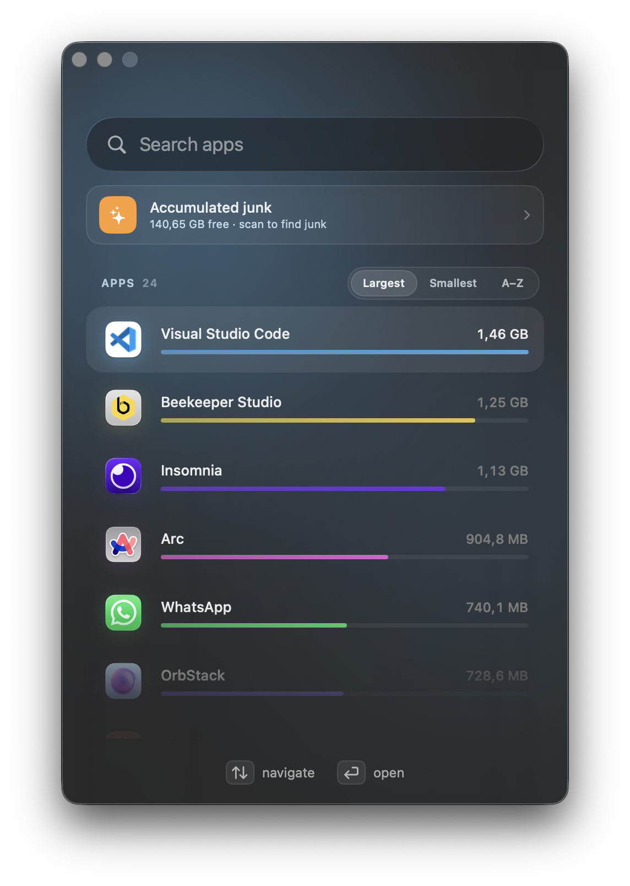
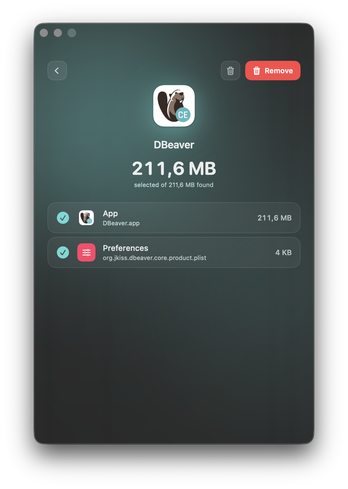
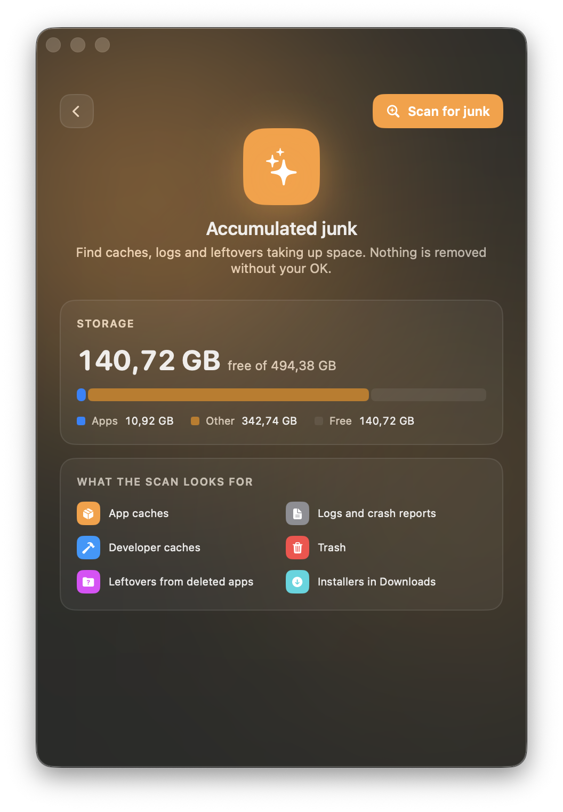

# Sweep

A native macOS app that uninstalls apps **completely**, not just the `.app` bundle, and cleans up junk that piles up over time.

Dragging an app to the Trash leaves caches, preferences, containers, logs and background services behind in `~/Library`. Sweep finds those leftovers, shows you each one with its size, and removes only what you approve.

<p align="center">
  
  
  
</p>

## Features

**Full uninstall**
- Lists every app in `/Applications` and `~/Applications`, with its size. Sort by largest, smallest or name, or search and use the keyboard (↑ ↓ ↩).
- Finds the app's files by its bundle id **and** the ids of the helpers bundled inside it (extensions, XPC services, login items).
- Groups each file by type (cache, preferences, container, background service…).
- Matches that rely only on the app's name start unchecked, so you review them first.
- Before removing, quits the app and its helper processes, unloads its launch agents and daemons, and unregisters it from Launch Services.
- Clears the app's cached preferences, so macOS doesn't write the `.plist` back.
- Moves everything to the Trash by default, or deletes it permanently if you choose. Protected system files ask for your administrator password.

**Accumulated junk**
- A storage overview (apps · other · free). The scan runs only when you ask for it.
- **Safe to clean**: app caches (caches of apps that are open are skipped), logs and crash reports, and developer caches (Xcode DerivedData, device support, simulators, npm, Gradle). The Trash is also listed, but starts unchecked.
- **Review first**: leftovers from apps that are no longer installed, and `.dmg`/`.pkg` installers in Downloads. These start unchecked and go to the Trash.

**Interface**
- A single compact window built with SwiftUI and Liquid Glass. Each screen's accent color comes from the app's icon.
- Localized in English, Portuguese (Brazil) and Spanish. It follows the system language and falls back to English.

## Requirements

- macOS 26 or later
- Xcode 26+ (Swift 6 toolchain) to build

## Build

```sh
git clone https://github.com/chmodami/sweep.git
cd sweep
./build.sh                      # builds build/Sweep.app
cp -R build/Sweep.app /Applications/
```

`build.sh` compiles with SwiftPM in release mode, assembles the `.app` bundle with its resources and translations, and signs it ad hoc.

## Permissions

Sweep runs outside the App Sandbox because it has to read and remove files that belong to other apps.

- **Data from other apps**: macOS asks for this the first time Sweep reads another app's container. Scanning waits until you answer.
- **Full Disk Access** (optional, in System Settings → Privacy & Security): needed to see some containers and the size of the Trash.
- **Administrator password**: requested only when a selected item is owned by the system, such as `/Library/LaunchDaemons` or a `.app` installed by a `.pkg`.

## How leftovers are detected

An item counts as a leftover of an app when its file name equals one of the app's identifiers, starts with one, or contains one after a team or group prefix. For example, all of these belong to `com.example.app`:

```
com.example.app
com.example.app.helper
com.example.app.plist
TEAMID.group.com.example.app
```

When the junk scan looks for orphans, an item is skipped if:
- it belongs to any installed or running app, or
- its vendor (`com.example`) still has another app installed, or
- it comes from a known system component or shared library.

Everything else is listed for review, never removed automatically.

## Project structure

```
Sources/Sweep/
  SweepApp.swift     App entry point, window, navigation
  AppModel.swift     State: apps, selection, removal, junk scan
  Scanner.swift      Finds installed apps and their files
  Remover.swift      Quits, unloads and removes, with admin fallback
  Junk.swift         Junk scanner and cleaner
  HomeView.swift     Search, app list, sort picker
  DetailView.swift   App details, confirmation panel, shared buttons
  JunkView.swift     Storage overview, scan results, charts
  ResultView.swift   Summary after removing
  Theme.swift        Categories, accent colors, chart palette, chip style
Resources/           Info.plist, icon, *.lproj translations
```

To add a language, create `Resources/<code>.lproj/Localizable.strings` with the translated keys, add the code to `CFBundleLocalizations` in `Info.plist`, and run `./build.sh`.

For testing, two launch arguments open the junk screen directly:

```sh
open -a Sweep --args -SweepOpenJunk YES -SweepScanJunk YES
```

## License

[MIT](LICENSE)
